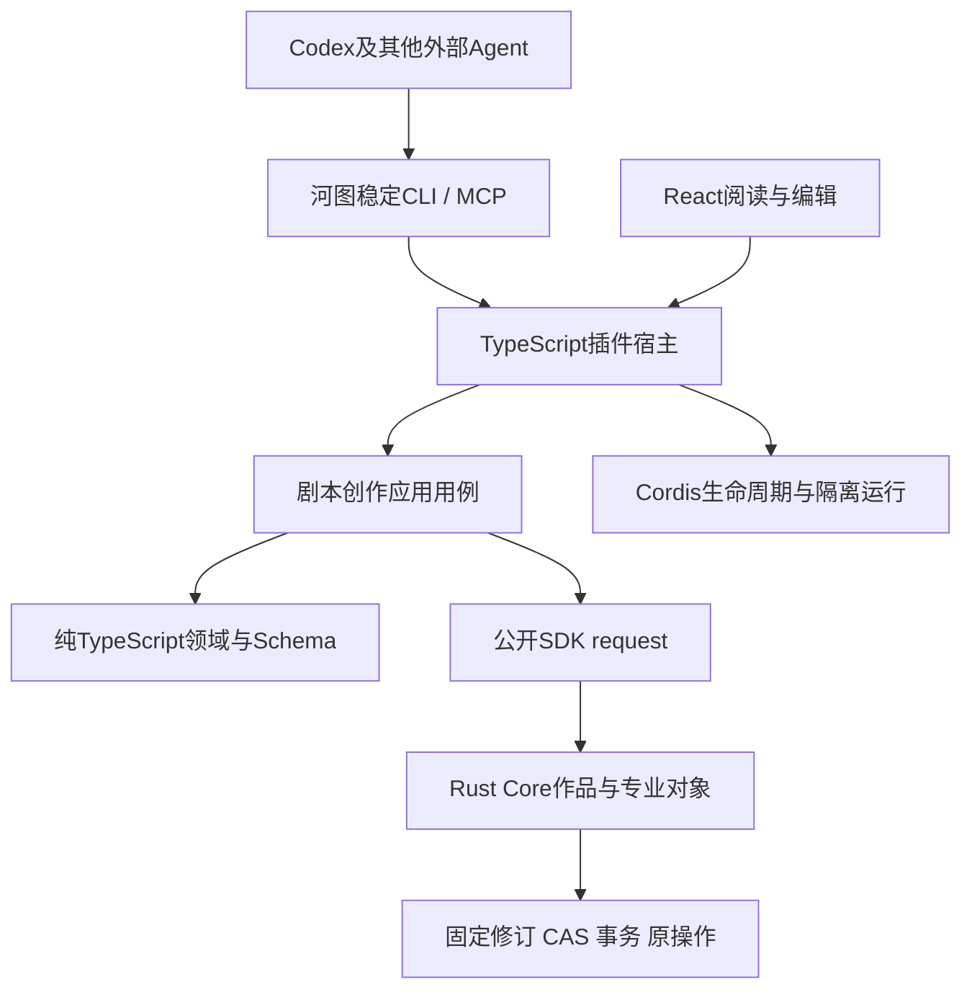

# 架构与技术选型

## 1. 技术栈

TypeScript领域与应用层、React阅读工作面、AJV Schema、esbuild独立包、Node 25插件后端；宿主内部Cordis不进入插件数据或业务。依赖固定于package-lock.json。插件只消费vendor中的公开SDK快照，来源摘要在vendor/sources.json。

## 2. 责任边界

宿主拥有WorkRef、正式目录与正文、素材、来源核验、修订、作者决定及事务。插件拥有专业方案及关联，不复制另一份正式正文或素材字节。每个专业方案为一个版本化聚合，跨对象引用固定版本；阶段、场次、镜头等不是宿主新增通用实体。

## 3. 持久化

使用hetu.extensions.objects的受管JSON对象及不可变历史，不部署独立数据库。单方案512KiB、单次返回和导出分块预算由合同和实现验证；大项目拆为多个有固定来源的方案。列表与范围投影避免反复发送全部内容。

## 4. 开放与演进

安装启用后复用公开核心，无独立插件授权步骤；Agent仍持有精确作品范围。专业格式1.0.0保持身份不变量；不兼容字段通过新schema_version与宿主固定迁移，升级不重写历史。

## 模块与部署单元

| 层 | 本仓库Owner | 运行位置 | 约束 |
| --- | --- | --- | --- |
| 领域 | src/domain/model.ts | 纯TypeScript；后端执行校验 | 树、引用、状态和专业不变量 |
| 应用 | src/application/project.ts | 宿主管理的Node进程 | 读原键、固定基线、至多一次保存 |
| 适配 | vendor公开SDK | 宿主request协议 | 不直读文件、不导入Rust或Electron内部实现 |
| 视图 | src/view | 隔离WebContentsView | React／Markdown／SVG，正文阅读优先 |
| 方法 | skills | 安装包静态UTF-8资源 | 外部Agent动态读取，按需载入 |
| 发行 | scripts/build.mjs | 开发机及CI | 独立后端和浏览器bundle，依赖及许可随包 |

Rust不进入插件技术栈，插件也不编译到Rust。跨进程只传语言无关数据，宿主内部Cordis负责注册与可撤销生命周期；业务模块不依赖Cordis，因此框架替换不要求改写专业格式。浏览器不编译Schema、不执行模型生成脚本，AJV仅在后端验证专业输入。

## 性能与边界

一个聚合最多512KiB和100项来源，超过预算明确分拆方案，不静默截断。get_project summary与get_scope支持先定位后按范围读取；export_project按固定修订与UTF-8字节偏移分页。前端恢复稿仅是本机缓冲，不能代替Core保存、固定版本或正式正文。

安装升级由宿主校验固定包，贡献由包清单声明。停用清理运行资源与视图，作品历史保持；同包重装仍回读原对象。专业格式不兼容时使用宿主固定迁移能力，不能在apply阶段自动改写数据。
