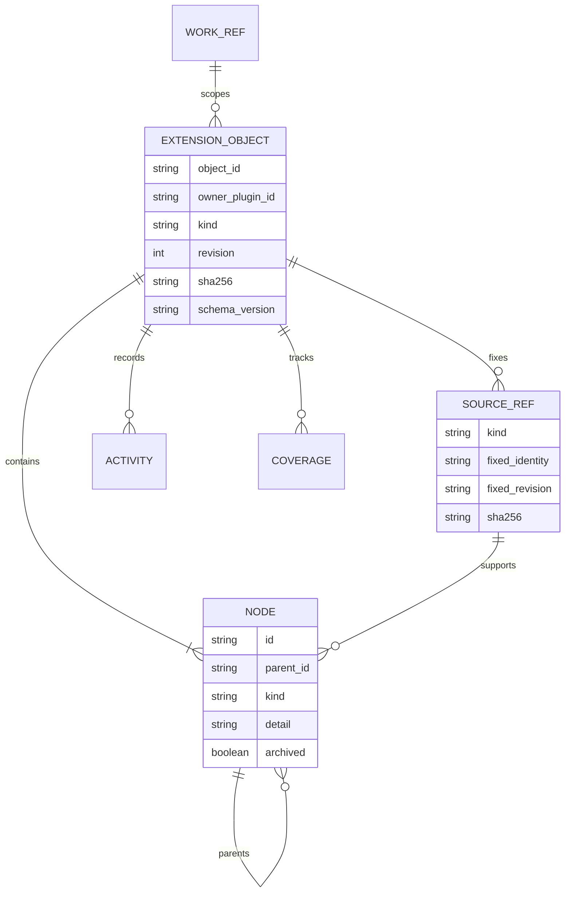

# 领域与数据合同

## 1. 数据Owner

包清单contracts/plugin-manifest.json为可执行Schema与动作唯一源；docs/examples由构建生成用于阅读，不手工维护第二套字段。专业对象归hetu-screenplay，作品类型固定为drama。

## 2. 聚合结构

方案包含标题、形式、作者约束、稳定节点树、人物弧线／关系／伏笔、阅读覆盖和工作记录。节点含目标、冲突、转折、起止状态、长剧情、来源与可选宿主分集映射。允许电影无集、短剧有集；层级按实际故事选用。

## 3. 不变量

ID唯一，根与已有对象类型不替换；更新或归档保留既有身份，不以标题去重。节点不可形成环，父子层级有效，重排不丢失原兄弟。所有引用解析到确切同方案对象；宿主引用固定WorkRef、修订与摘要并经核心核验。历史比较固定两端，导出固定同一修订，不能把当前子对象拼成旧版本。

## 4. 状态与证据

分析推断、候选计划、Agent自查、外部提供方声明、技术验证和作者决定保持来源语义。不因字段state=succeeded推断影片合格或作者认可。正文与素材仅引用宿主固定对象，插件无正式采纳动作。

## 5. 存储与索引

对象键由宿主按WorkRef／owner_plugin_id／kind分区，修订和原操作由Core事务持有。插件不直接读写.hetu，不部署SQL数据库；标题检索与列表使用宿主派生索引。

## 逻辑数据模型

下图为同一受管JSON聚合内的逻辑关系，不创建独立SQL数据库或第二套宿主事实。物理事务、修订和原操作回执由Core持有。

完整字段由contracts/plugin-manifest.json贡献的Schema及docs/examples生成文件维护。format_version标识专业格式；Schema额外字段关闭，字符串和数组有上限，节点按稳定ID而不是标题关联。source_indices引用同一对象的source_refs，既有索引只追加，不重定向。

## 版本与事务

保存读取固定expected_revision与expected_sha256，Core最终核验当前头。操作键由宿主绑定专业action及完整input的指纹；返回丢失后get_operation读取原回执，不重新应用变更。历史读取与比较固定两端，fork产生新对象并保留固定来源。节点和既有专业身份不能删除，归档后仍可恢复和审计。

## 剧本专业语义

人物弧线以节点固定状态、选择、代价和认知，不用全局简介覆盖每次出场。关系端点必须指向人物，范围节点必须存在；伏笔按plant／develop／payoff落到具体节点，resolved至少包含一次payoff。检查未解伏笔属于创作提醒，不强制作者采用闭合结局。

formal_episode_id仅用于episode节点，不能由标题推测。map_episode读取宿主正式分集并追加固定作者稿来源；read_manuscript明确分开方案固定原稿与当前作者稿／候选。角色、场次和剧情计划不成为第二份正式正文。电影可用work→sequence→scene或work→scene；系列可插入season和episode，层级可省略而不能倒置。
