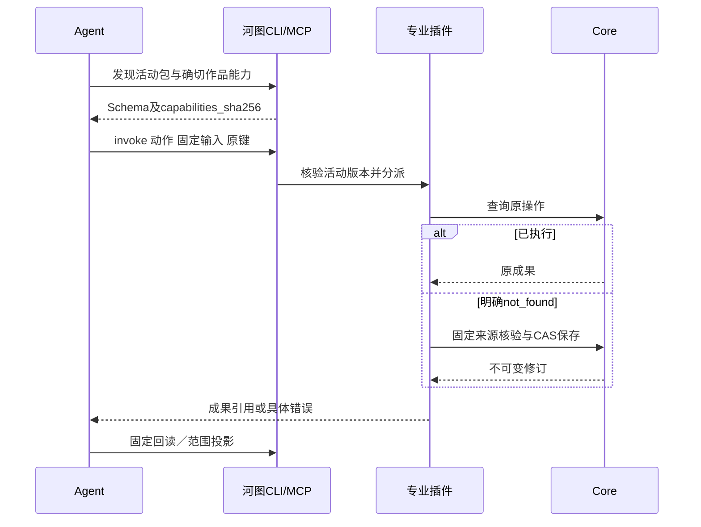

# API与Agent协作

## 1. 动态发现

Codex→河图CLI/MCP→plugins.inspect→plugins.capabilities→plugins.invoke。工具名稳定，hetu-screenplay不另装Codex插件、不增加专属MCP连接。Skill通过skills.read读取主入口及同包references。停用、升级和重装重新发现包与能力摘要。

## 2. 专业动作

功能入口及动作清单唯一由CAPABILITIES.md与实际贡献维护。通用能力包括列表／固定读取、范围投影、保存、节点维护、分支、比较、检查、导出、工作记录与精确交接。专业动作由各自领域验证后调用同一受管保存；不绕过宿主作者决定。

## 3. 保存与恢复

写入必须带expected_revision、expected_sha256和operation_key，新建为0与空摘要。每个专业动作最多一次权威保存；调用输入指纹由宿主绑定原键，禁止同键异参。unknown先get_operation；原回执不存在才沿原输入继续。CAS保留本地稿并比较，不能换expected自动覆盖。

## 4. 正文与制作接续

prepare_handoff返回固定方案、所选节点与已有证据，Agent据宿主实际能力准备任务。GUI交接由宿主追加实际管理范围，插件不持久化私密grant。付费调用、采纳、定稿及外部交付分别遵守当前会话决定。

## 5. 宿主工作面服务

普通导出调用host.export_file，插件返回固定project_ref与连续UTF-8字节分块及块摘要。视频预览调用host.media_open传固定asset来源，由宿主返回会话内临时URL，离开专题或关闭视图释放。专属隔离会话只允许本会话已签发的媒体，插件不接触物理路径。

## 动作行为与返回

- list_projects调用Core分页列表或标题检索；get_project返回固定对象，summary省略长详情；get_scope返回选中子树、路径、相关专业元素和固定依据。
- save_project全量保存；upsert_node按稳定ID更新；move_node验证层级；reorder_nodes必须列全兄弟；archive_node不移除身份。局部动作保留未改字段和既有来源。
- add_note追加不可改写的工作记录。fork_project固定旧修订创建备选，compare_versions返回字段差异与目录顺序变化；check_project只表示结构和依据检查。
- prepare_handoff返回固定方案、节点、目标与恢复说明，不返回私密管理授权。GUI交接由受信宿主补充实际management_ref和机器连接。
- export_project返回project_ref、media_type、content、content_sha256、offset、next_offset及total_bytes；next_offset=null为完整结束，偏移不能切断UTF-8字符。
- get_operation查询原键；请求未知时先回读。写动作复用原键原输入；不同输入不得复用已有键。

完整必填参数由Skill的references/operations.md生成，具体字段类型由当前plugins.capabilities返回，不在文档复制另一份Schema。

## 错误处理

| 结果 | 调用方动作 |
| --- | --- |
| invalid_input | 修改明确失败输入后准备新操作；不猜测字段 |
| not_found | 核对确切对象；原操作明确不存在才沿原输入执行 |
| revision_conflict | 保留本地稿，固定旧版与当前版比较，作者选择冲突字段后建立新基线 |
| idempotency_conflict | 找回原请求，不能用新内容冒用旧键 |
| hetu.stale_evidence | 原来源不可替换；核对实际固定版本再追加 |
| unknown／传输错误 | 保存完整请求、原键、固定包及能力摘要，继续回读 |
| 包停用或摘要改变 | 重新发现活动包与Schema，再判断能否恢复原操作 |

GUI恢复稿保留最初固定基线与完整待执行请求。重新打开不静默改用当前头作为编辑基线；三方合并保留远端未修改字段，对同字段冲突逐项选择，确认后仍须保存才产生新修订。
