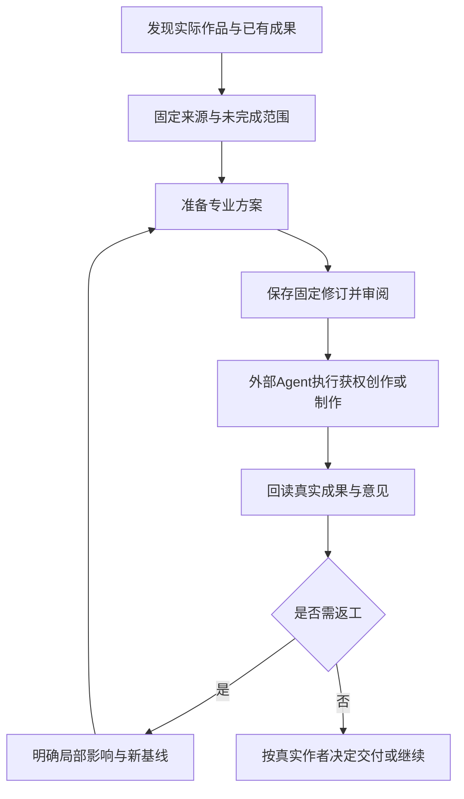

# 用户用例与推进流程

## 1. 完整旅程

SC-01原创短片无分集；SC-02只有旧大纲；SC-03已有剧本逐集复盘；SC-04固定原著改编；SC-05全剧到场次；SC-06人物弧线及知情变化；SC-07伏笔铺设与回收；SC-08局部改线；SC-09宿主分集映射；SC-10两版Fountain及真实意见；SC-11采用后增量复盘；SC-12多备选比较与固定导出。

## 2. 主流程

## 3. 恢复与负例

同键异参、CAS旧基线、跨作品引用、错误类型、树环、归档与恢复、标题重复、插件停用／升级、未知回执、历史摘要不符、缺失源文件均保留明确结果。不以空列表视为整部作品已读，不以单次成功视为全项目完成。
